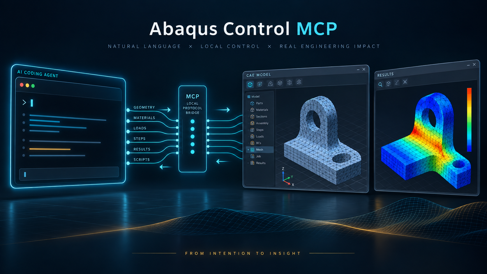
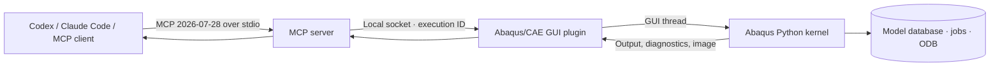

# Abaqus Control MCP

**A local MCP bridge for Abaqus/CAE automation.** Run CAE Python, monitor jobs, inspect ODB data, and capture the viewport from Codex, Claude Code, or another MCP client.



[中文说明](README_ZH.md) · [Installation](#quick-start) · [Tools](#six-tools) · [Architecture](#how-it-works)

**Version 2.0.0** · MCP protocol `2026-07-28` · Local bridge for Codex, Claude Code, and other MCP clients

## What you can do

- **Work in the open CAE session.** `run_python` runs Abaqus Python against the current `mdb` and `session`; model changes remain visible in the GUI.
- **Trust each response.** Every bridge call has an `executionId`. Return values, output, and concise error diagnostics belong to that call. A statement script returns a value only when it assigns `result`.
- **Follow a solve.** `monitor_job_status` combines CAE status with `.log`, `.sta`, `.dat`, and `.msg` evidence. It reports terminal state, progress, diagnostics, and uncertainty. Its `terminate=true` option requests a kill and separately reports confirmation.
- **Ask the ODB a numerical question.** `inspect_odb` describes steps and frames, summarizes a field by step/frame/set, or returns a bounded history curve. Step `startTime`, `endTime`, and `duration` have explicit meanings.
- **See the viewport.** `capture_viewport` returns a native MCP image content block; optionally save it to a file. Image base64 stays out of the structured response.

The project is designed for an engineer supervising a live simulation. `run_python` has the same power as the Abaqus scripting console, so review generated modelling and job commands before relying on their results.

## How it works



The server runs in its own Python environment or as a standalone Windows executable. The plugin runs inside Abaqus/CAE and uses Abaqus's Python. The socket listens on `127.0.0.1:48152` by default.

## Quick start

**Requirements:** Abaqus/CAE with Python 3 support. A source installation needs Python 3.10+ and [`uv`](https://docs.astral.sh/uv/) or `pip`; the Windows release executable needs no separate Python installation for the server. Abaqus versions with Python 2 need the [compatible fork](https://github.com/hp283260133-bit/Abaqus-Control-MCP-abaqus2021).

1. **Get the MCP server.** Install from source:

   ```bash
   uv tool install git+https://github.com/Whfkl/Abaqus-Control-MCP.git
   ```

   On Windows, you can instead extract the [release ZIP](docs/windows-release.md) and use `Abaqus-Control-MCP-Server.exe`. For development from a checkout, run `uv sync` and use `uv run` for the commands below.

2. **Put the GUI plugin in Abaqus's plugin directory.** For the `uv tool` installation, run `abaqus-control-setup` (or `uv run abaqus-control-setup` from a checkout). This copies `abaqus_mcp_gui_plugin.py` to `~/abaqus_plugins/` by default. For the Windows release ZIP, copy its `abaqus_mcp_gui_plugin.py` to `%USERPROFILE%\abaqus_plugins\`. If Abaqus uses a different plugin directory, set `ABAQUS_MCP_PLUGIN_DIR` for setup or copy the file there yourself.

3. **Configure your MCP client.** For Codex with the source installation:

   ```bash
   codex mcp add abaqus-control-mcp --env ABAQUS_MCP_HOST=127.0.0.1 --env ABAQUS_MCP_PORT=48152 --env ABAQUS_MCP_TIMEOUT=120 -- abaqus-control-mcp-server
   codex mcp get abaqus-control-mcp
   ```

   For the Windows release, replace `abaqus-control-mcp-server` with the full path to `Abaqus-Control-MCP-Server.exe`. In Claude Code or another client, register the same command or exe as a **stdio** MCP server with the same environment variables. Set the client's tool timeout above `ABAQUS_MCP_TIMEOUT` for long CAE operations.

4. **Open Abaqus/CAE and test.** Start or restart Abaqus/CAE so it loads the plugin, then choose **Plug-ins → Abaqus-Control-MCP → Start MCP Bridge**. Open a new MCP client session, call `ping`, then call `run_python` with `result = list(mdb.models.keys())`. For a source installation, `abaqus-control-check` provides an additional connection check.

### Install with an AI agent

Copy this prompt into Codex, Claude Code, or another local agent with file and terminal access:

```text
Install Abaqus-Control-MCP from https://github.com/Whfkl/Abaqus-Control-MCP on this computer. Check the OS and the MCP client I am using. On Windows, use the matching release ZIP and standalone server exe if available; otherwise install the server with uv. Then put abaqus_mcp_gui_plugin.py in the Abaqus plugin directory (normally ~/abaqus_plugins, or %USERPROFILE%\abaqus_plugins on Windows). Configure my current MCP client to launch the server over stdio, using its full exe path or the installed command, without changing unrelated MCP entries. After configuration, tell me to open or restart Abaqus/CAE and select Plug-ins → Abaqus-Control-MCP → Start MCP Bridge. Open a new client session and verify ping plus run_python with code: result = list(mdb.models.keys()). Report the installed paths and actual test results; if Abaqus/CAE is unavailable, report which setup steps are complete and what remains to test.
```

## Six tools

| Tool | Purpose | Useful inputs |
| --- | --- | --- |
| `ping` | Verify the connected CAE session and identify models and viewports | none |
| `run_python` | Execute Python; return this call's value, output, and full error location | `code` |
| `set_workdir` | Set an existing absolute CAE working directory | `path` |
| `monitor_job_status` | List jobs or inspect progress, terminal evidence, and diagnostics; request termination with confirmation | `job_name`, optional `terminate`, `since` |
| `inspect_odb` | Describe an ODB; summarize a field or retrieve a history curve | `odb_path`, optional `step`, `frame`, `variable`, `set_name`, `component`, `history_region`, `history_variable` |
| `capture_viewport` | Return a native image and optionally save it; SVG/EPS/PS exports require a path | optional `viewport_name`, `image_format`, `save_path` |

### Common calls

```text
run_python(code="print('current models:', list(mdb.models.keys()))")
set_workdir(path="D:/analysis/run-01")
monitor_job_status(job_name="Job-1")
inspect_odb(odb_path="D:/analysis/run-01/Job-1.odb", step="Step-1", frame=-1, variable="U", component="U3")
inspect_odb(odb_path="D:/analysis/run-01/Job-1.odb", step="Step-1", history_region="Assembly ASSEMBLY", history_variable="ALLIE")
capture_viewport(save_path="D:/analysis/run-01/viewport.png")
```

`monitor_job_status` returns `UNKNOWN` when CAE status and file evidence conflict. If the job is absent from CAE, file-only terminal evidence also stays `UNKNOWN` unless `since` supplies the run's submission time as a Unix timestamp. A kill request is distinct from confirmed termination. A timeout while Python is already running has an unknown outcome: do not blindly submit the same modelling command again.

For vector fields, an omitted `component` returns magnitude. For tensor fields, select a component. History curves return at most `max_points` sampled pairs and report the full point count. ODB files are opened read-only.

## Configuration and diagnostics

| Environment variable | Default | Use |
| --- | --- | --- |
| `ABAQUS_MCP_HOST` | `127.0.0.1` | GUI bridge address |
| `ABAQUS_MCP_PORT` | `48152` | GUI bridge port |
| `ABAQUS_MCP_TIMEOUT` | `120` | Seconds to wait for a kernel call |
| `ABAQUS_MCP_PLUGIN_DIR` | `~/abaqus_plugins` | Plugin installation directory |
| `ABAQUS_MCP_DEBUG` | off | Write a bounded GUI plugin debug log in the temporary directory |

Run `abaqus-control-doctor --verify-connection` for installation and connectivity details. If connection is refused, check that Abaqus/CAE is open and **Start MCP Bridge** has been selected. If the GUI plugin was updated, restart CAE before evaluating plugin-side changes. The GUI plugin does not create a request log by default; set `ABAQUS_MCP_DEBUG=1` before starting CAE to enable a rotating debug log. No output from `abaqus-control-mcp-server` on stdout is normal for a stdio MCP server.

## Community Adoption and Ecosystem Impact

Since its open-source release, the designs and implementations of Abaqus-Control-MCP have been adopted and further developed by other open-source projects. We are glad to see this project advancing the integration of AI and engineering simulation and serving as a technical foundation for related tools.

- [CAE-Agent-Hub](https://github.com/Cai-aa/CAE-Agent-Hub) adopted and adapted this project's live execution and diagnostic architecture in commit [`5bd51ff`](https://github.com/Cai-aa/CAE-Agent-Hub/commit/5bd51ff41cf39f5300451684fd90039ce9167c10) on May 25, 2026, including the local socket bridge, GUI-thread dispatch, persistent execution context, and AST-driven error diagnosis and recovery mechanisms.
  - The relevant upstream implementation was available in the initial Abaqus-Control-MCP release, commit [`cc4ab0b`](https://github.com/Whfkl/Abaqus-Control-MCP/commit/cc4ab0bc8e9ed5bea8f8a9e6de5d8471345acf4a), on May 10, 2026.
  - CAE-Agent-Hub provides attribution under the MIT License in its [`THIRD_PARTY_NOTICES.md`](https://github.com/Cai-aa/CAE-Agent-Hub/blob/5bd51ff41cf39f5300451684fd90039ce9167c10/MCP/Abaqus/THIRD_PARTY_NOTICES.md).

We welcome and encourage developers to explore, improve, and build new tools upon Abaqus-Control-MCP. The value of open source lies in enabling good ideas to be reused, advanced, and shared with the broader community. If your project adopts designs or implementations from this project, feel free to open an Issue or submit a Pull Request to share your work and be included in this list. Together, we can explore more possibilities for AI-driven engineering simulation.

## License

MIT — see [LICENSE](LICENSE).
