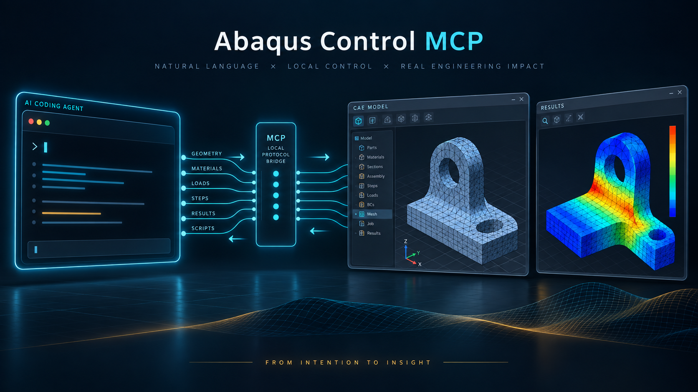
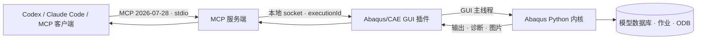

# Abaqus Control MCP

**面向 Abaqus/CAE 自动化的本地 MCP 桥接。** 通过 Codex、Claude Code 等客户端运行 CAE Python、监测作业、查询 ODB 和获取视口图像。



[English](README.md) · [快速开始](#快速开始) · [六个工具](#六个工具) · [架构](#工作原理)

**版本 2.0.0** · MCP 协议 `2026-07-28` · 适用于 Codex、Claude Code 等 MCP 客户端的本地桥接

## 可以做什么

- **直接操作当前 CAE 会话。** `run_python` 在 Abaqus 内核执行 Python，访问当前 `mdb` 和 `session`；模型变化在 GUI 中可见。
- **每次结果可追溯。** 每次桥接调用都有独立 `executionId`。返回值、输出和精简错误诊断只对应本次调用；多行脚本需要显式赋值 `result` 才有返回值。
- **判断求解是否真正结束。** `monitor_job_status` 综合 CAE 状态以及 `.log`、`.sta`、`.dat`、`.msg`，返回终态、步与增量、诊断和证据。可通过 `terminate=true` 请求终止，并单独查看是否确认。
- **直接查询 ODB 数值。** `inspect_odb` 除了列出步、帧和变量，还可查询指定步、帧、集合、变量的最小/最大值和历史曲线；步时间分别标为起始、结束和持续时间。
- **让智能体看见视口。** `capture_viewport` 返回 MCP 原生图片内容块，也可保存到文件；结构化文本不含图片 base64。

`run_python` 拥有与 Abaqus 脚本控制台相同的权限。工程师应检查智能体生成的建模与作业命令，并复核分析结果。

## 工作原理



服务端可运行在独立 Python 环境中，也可使用 Windows 独立 exe；插件在 Abaqus/CAE 内使用 Abaqus 自带的 Python。桥接默认监听 `127.0.0.1:48152`。

## 快速开始

**需要：**已安装并运行的 Python 3 版 Abaqus/CAE。源码安装服务端需要 Python 3.10+，推荐 [`uv`](https://docs.astral.sh/uv/)；Windows 发行版 exe 的服务端无需另行安装 Python。Python 2 版 Abaqus 请使用[兼容分支](https://github.com/hp283260133-bit/Abaqus-Control-MCP-abaqus2021)。

1. 安装服务端和 GUI 插件：

   ```bash
   uv tool install git+https://github.com/Whfkl/Abaqus-Control-MCP.git
   abaqus-control-setup
   ```

   在本地源码中开发时使用 `uv sync` 和 `uv run abaqus-control-setup`。安装或更新插件后重启 Abaqus/CAE。

   Windows 独立发行包包含服务端 exe 和 GUI 插件，安装步骤见 [Windows 发行包说明](docs/windows-release.md)。GUI 插件仍需在 Abaqus/CAE 中运行。

2. 在 Abaqus/CAE 菜单选择 **Plug-ins → Abaqus-Control-MCP → Start MCP Bridge**。

3. 在 MCP 客户端注册服务端。Codex 示例：

   ```bash
   codex mcp add abaqus-control-mcp --env ABAQUS_MCP_HOST=127.0.0.1 --env ABAQUS_MCP_PORT=48152 --env ABAQUS_MCP_TIMEOUT=120 -- abaqus-control-mcp-server
   codex mcp get abaqus-control-mcp
   ```

   Claude Code 中添加 stdio MCP 服务端，命令为 `abaqus-control-mcp-server`，环境变量同上。耗时操作时，客户端的工具超时应大于 `ABAQUS_MCP_TIMEOUT`。修改配置后开启新的客户端会话。

4. 运行 `abaqus-control-check` 检查连接；再让客户端调用 `ping` 和 `run_python(code="result = list(mdb.models.keys())")`。

## 六个工具

| 工具 | 用途 | 常用输入 |
| --- | --- | --- |
| `ping` | 检查 CAE 连接、模型及视口 | 无 |
| `run_python` | 执行 Abaqus Python，返回本次输出与完整异常位置 | `code` |
| `set_workdir` | 设置已存在的绝对工作目录 | `path` |
| `monitor_job_status` | 查询作业进度、终态和诊断；可请求终止并确认 | `job_name`、可选 `terminate`、`since` |
| `inspect_odb` | 查看 ODB 概览、场变量范围或历史曲线 | `odb_path`，可选步、帧、变量、集合、分量、历史区域 |
| `capture_viewport` | 返回原生图片，也可保存；SVG/EPS/PS 需提供保存路径 | 可选视口、格式、路径 |

### 常用调用

```text
run_python(code="print(list(mdb.models.keys()))")
set_workdir(path="D:/analysis/run-01")
monitor_job_status(job_name="Job-1")
inspect_odb(odb_path="D:/analysis/run-01/Job-1.odb", step="Step-1", frame=-1, variable="U", component="U3")
inspect_odb(odb_path="D:/analysis/run-01/Job-1.odb", step="Step-1", history_region="Assembly ASSEMBLY", history_variable="ALLIE")
capture_viewport(save_path="D:/analysis/run-01/viewport.png")
```

CAE 状态与文件证据冲突时，`monitor_job_status` 会返回 `UNKNOWN`。若当前 CAE 中没有此作业，仅凭文件标记也返回 `UNKNOWN`；可以用 Unix 时间戳 `since` 指定本次提交时间，排除旧日志。发出 kill 请求不等于已确认终止。若 Python 执行中超时，结果也不能视为已停止，不要盲目重试同一建模脚本。

向量变量不指定 `component` 时统计模长；张量变量需指定分量。历史曲线最多返回 `max_points` 个采样点，并同时给出原始点数。ODB 以只读方式打开。

## 配置与排障

| 环境变量 | 默认值 | 用途 |
| --- | --- | --- |
| `ABAQUS_MCP_HOST` | `127.0.0.1` | GUI 桥接地址 |
| `ABAQUS_MCP_PORT` | `48152` | GUI 桥接端口 |
| `ABAQUS_MCP_TIMEOUT` | `120` | 等待内核调用的秒数 |
| `ABAQUS_MCP_PLUGIN_DIR` | `~/abaqus_plugins` | 插件安装目录 |
| `ABAQUS_MCP_DEBUG` | 关闭 | 在临时目录写入有大小上限的 GUI 插件调试日志 |

运行 `abaqus-control-doctor --verify-connection` 查看安装及连接信息。连接被拒绝时，检查 Abaqus/CAE 是否打开、是否点击 **Start MCP Bridge**。更新插件后要重启 CAE 才能验证插件侧的新行为。GUI 插件默认不生成请求日志；需要排障时，在启动 CAE 前设置 `ABAQUS_MCP_DEBUG=1`，即可启用轮转调试日志。stdio MCP 服务端不向 stdout 输出日志是正常现象。

## 社区采用与生态影响

自开源以来，Abaqus-Control-MCP 的设计与实现已被其他开源项目采用并进一步发展。我们很高兴看到本项目推动 AI 与工程仿真的结合，并逐渐成为相关工具的重要技术基础。

- [CAE-Agent-Hub](https://github.com/Cai-aa/CAE-Agent-Hub) 在 2026 年 5 月 25 日的提交 [`5bd51ff`](https://github.com/Cai-aa/CAE-Agent-Hub/commit/5bd51ff41cf39f5300451684fd90039ce9167c10) 中采用并改写了本项目的实时执行与诊断架构，包括本地 socket bridge、GUI 主线程调度、持久化执行上下文，以及基于 AST 的错误诊断与恢复机制。
  - 本项目相关上游实现已包含在 2026 年 5 月 10 日的首次发布提交 [`cc4ab0b`](https://github.com/Whfkl/Abaqus-Control-MCP/commit/cc4ab0bc8e9ed5bea8f8a9e6de5d8471345acf4a) 中。
  - CAE-Agent-Hub 已在其 [`THIRD_PARTY_NOTICES.md`](https://github.com/Cai-aa/CAE-Agent-Hub/blob/5bd51ff41cf39f5300451684fd90039ce9167c10/MCP/Abaqus/THIRD_PARTY_NOTICES.md) 中依据 MIT License 标注来源。

我们欢迎并鼓励开发者基于 Abaqus-Control-MCP 探索、改进和构建新的工具。开源的价值在于让优秀的想法被复用、发展，并惠及更广泛的社区。若您的项目采用了本项目的设计或实现，欢迎提交 Issue 或 Pull Request，与社区分享您的成果并加入此列表。让我们共同探索 AI 驱动工程仿真的更多可能。

## 许可证

MIT，见 [LICENSE](LICENSE)。
